# CCTVPanelView

<div align="center">


### CCTV monitoring and recording for Windows

A desktop viewer for RTSP/ONVIF IP cameras, with motion alerts, optional on-device object detection, local recording, and a browser interface for phones and tablets.

**Enjoying CCTVPanelView?** [♥ Support the project on Ko-fi](https://ko-fi.com/skidesign)

Your support helps fund continued development, improvements and bug fixes. Thank you!

[**Download for Windows**](https://github.com/SKIZZOO/CCTVPanelView/releases/latest) · [Features](#what-you-can-do) · [Quick start](#install-the-windows-release) · [Security](#security-and-privacy) · [2.3.6 readable phone attachments](docs/RELEASE-2.3.6.md)


</div>

---

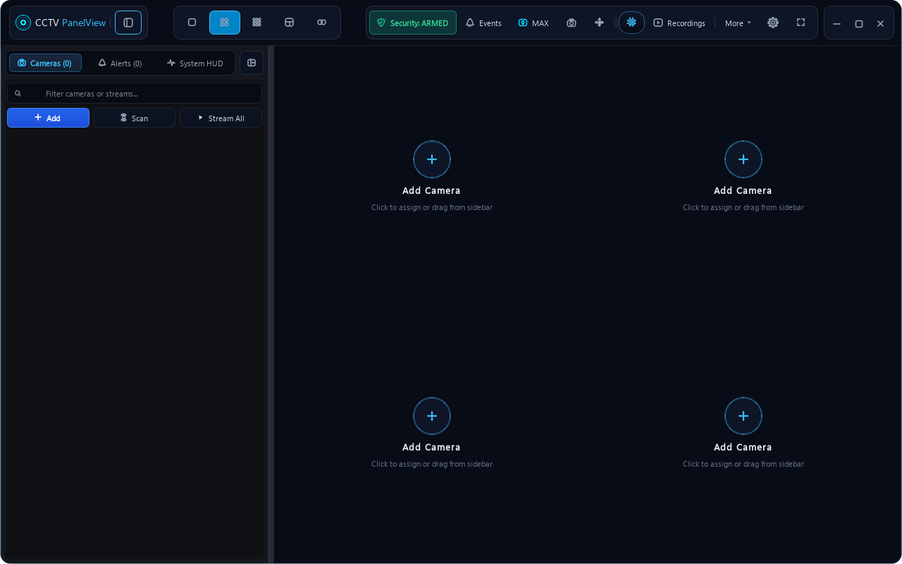

## What you can do

| Live monitoring | Recording and alerts | Browser access |
| --- | --- | --- |
| View cameras in up to 16 tiles or a custom layout. Maximize a tile, zoom, and use supported camera controls. | Record video, save snapshots, set storage and retention options, and configure motion or object alerts. | Open the optional web viewer on a phone, tablet, or another browser. View supported camera feeds, alerts, and PTZ actions. |

CCTVPanelView is designed for trusted home and small-site networks. Camera compatibility and performance depend on the camera model, stream format, PC, and network. It has not been benchmarked for a fixed camera count.

## Screenshots

### Desktop setup and camera management

<table>
<tr>
<td width="50%">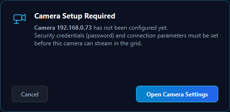<br><sub>Choose initial setup tasks at first launch.</sub></td>
<td width="50%">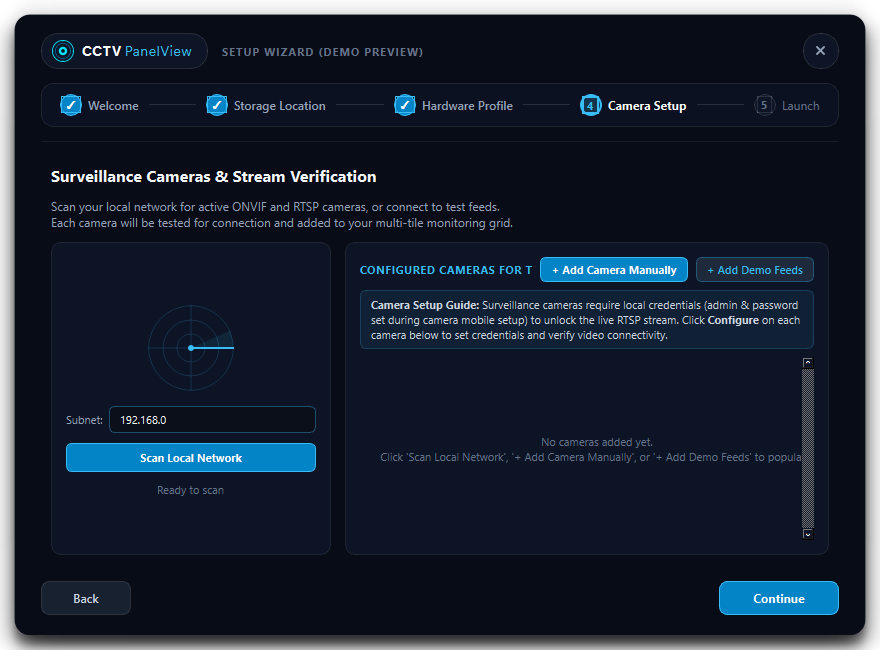<br><sub>Add a camera and enter its connection details.</sub></td>
</tr>
<tr>
<td width="50%">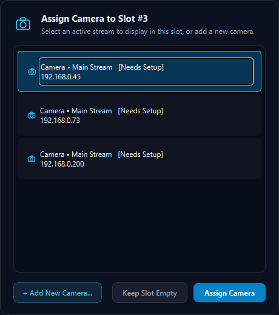<br><sub>Assign a configured camera to a video tile.</sub></td>
<td width="50%">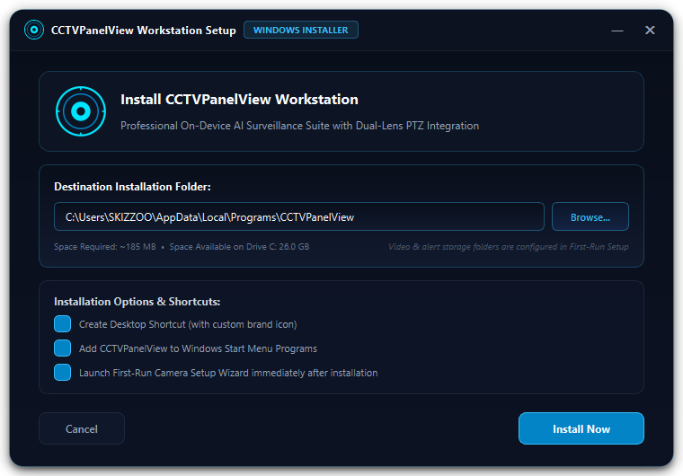<br><sub>Install the packaged Windows application.</sub></td>
</tr>
</table>

### Settings

Settings is grouped into **General & Layout**, **Alerts & Sounds**, **Detection**, **Recording & Storage**, **Cameras & Image**, and **PC Performance**. Use the search field to find controls by name.

In the incident feed, choose **Motion**, **Person**, **Animal**, or **Car / vehicle** to filter existing and incoming alerts. The choices persist across restarts. Display filters do not stop detection, recording, or separately configured notifications.

To send **only people notifications**, open **Settings → Alerts & Sounds → Send notifications for** and click **People only**. Enable Mobile Push Alerts and configure your chosen service. The category switches apply to both photos and clips sent through ntfy, Telegram, and Discord. Turning every category off sends none. Choices survive saving, restarting, and disarming/rearming.

Under the ntfy topic, **Send text-only test** checks the currently entered topic without sending camera data. The result appears in Settings. Snapshot and video attachments are uploaded directly to ntfy; Google Drive synchronization is not required. If the server rejects an attachment as too large, the app sends a text alert instead. Server acceptance is checked using ntfy's message acknowledgement; HTTP errors and invalid proxy responses are reported as failures.

The Windows package includes certifi's public CA bundle so HTTPS delivery does not fail when default Windows trust loading is unavailable. Certificate and hostname verification stay enabled. This also applies to updater HTTPS; explicit `SSL_CERT_FILE` / `SSL_CERT_DIR` settings are respected.

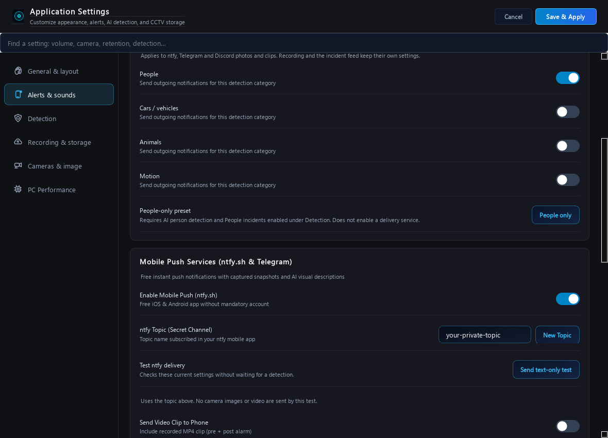

**Detection → Create incident alerts** controls which local incidents are created. Keep AI person detection and People incidents enabled to receive person notifications. These controls are independent of outgoing notification categories and the sidebar's display filters.

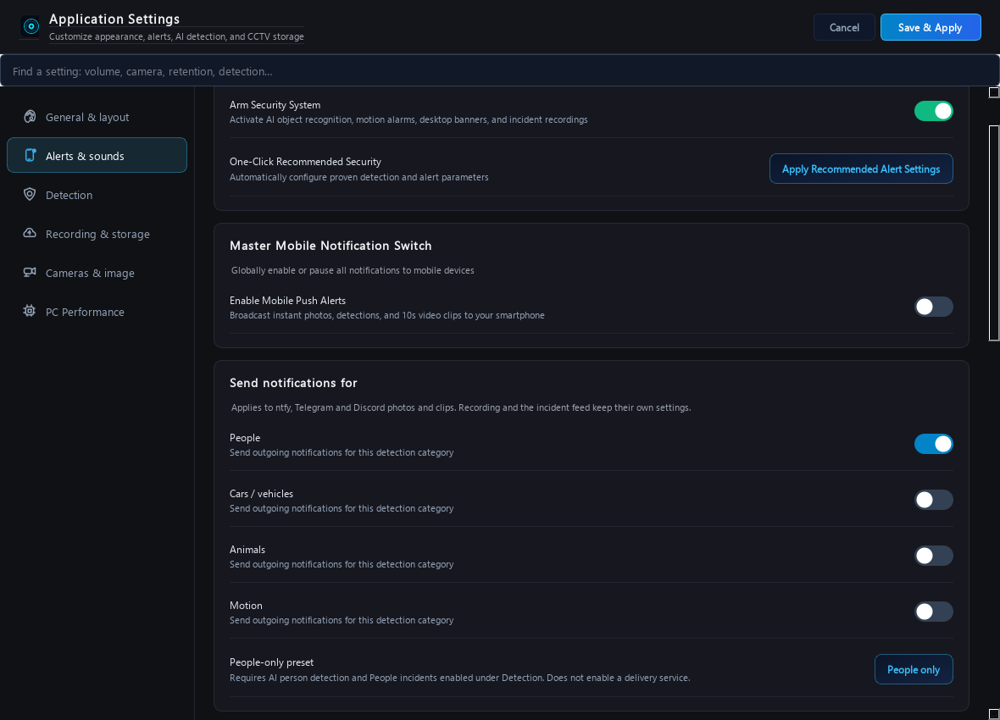

Frigate integration is deferred. See the [Frigate security and integration review](docs/FRIGATE-REVIEW-2026-10-27.md) before deploying a separate server; CCTVPanelView does not install or connect to Frigate in this release.

Siren previews and actual alerts use the same 0–100% volume setting. Choose a built-in profile or a custom PCM WAV file; 0% mutes playback. The Windows default playback device is used.

<table>
<tr>
<td width="50%">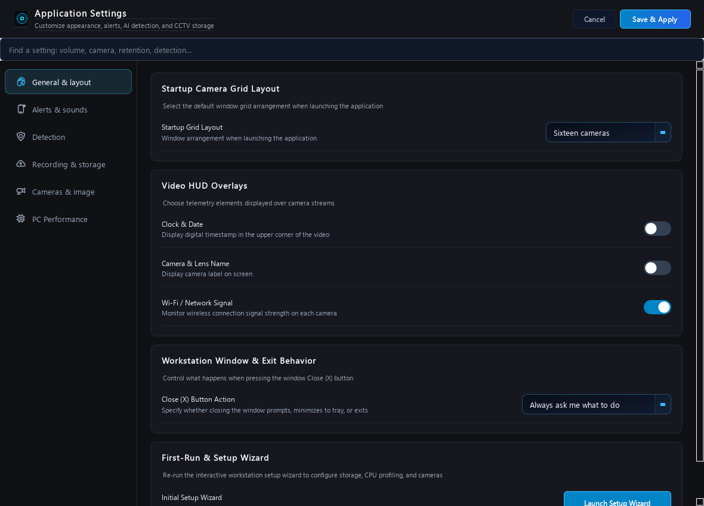<br><sub>Appearance and window behavior.</sub></td>
<td width="50%">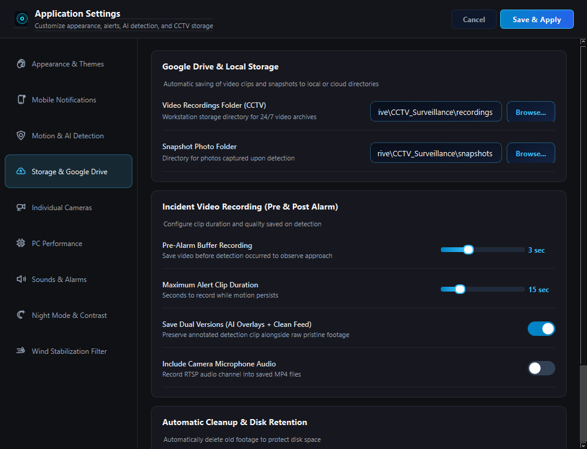<br><sub>Recording location and retention settings.</sub></td>
</tr>
<tr>
<td width="50%">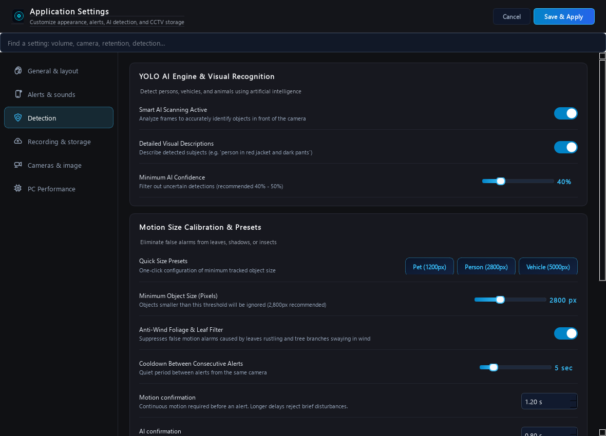<br><sub>Motion and local object-detection options.</sub></td>
<td width="50%">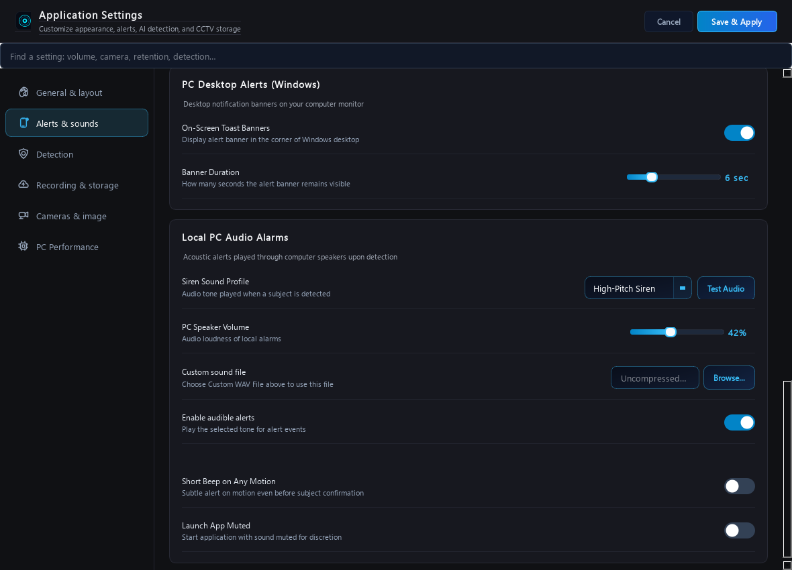<br><sub>Notification delivery and working alarm-volume controls.</sub></td>
</tr>
</table>

## Layout persistence, usage preview and intercom

The last grid and camera assignments are saved when the layout changes and on exit, including custom-layout assignments and hidden slots. CPU usage includes the app and its decoder/helper processes, sampled in the background. AI models and alert-media indexing load away from the UI thread to reduce startup stalls.

The intercom supports cameras that advertise an **ONVIF audio backchannel with 8 kHz mono G.711 PCMA or PCMU**. It selects the advertised speaker track, codec and TCP channel, supports Basic/MD5 Digest authentication, and converts supported native microphone formats. Select a microphone and use push-to-talk or hands-free mode. Changing cameras, microphones, or closing the panel stops transmission.

A camera having a speaker does not guarantee an open backchannel. Devices that expose talk only through a proprietary vendor app are not currently supported. The app reports missing capabilities rather than assuming an arbitrary audio track.

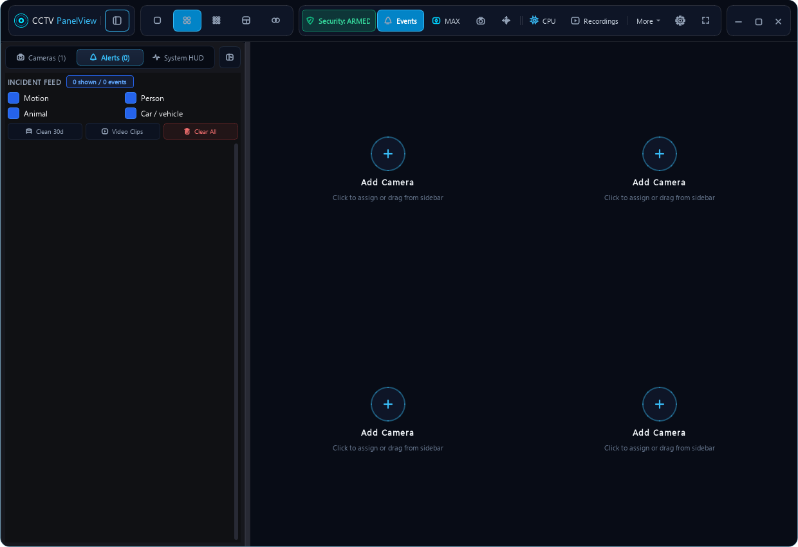

## Camera setup and connection tests

Enter or paste the complete stream URL in Camera Settings. **Test Connection** verifies that exact URL and requires a decoded video frame; it does not replace a custom path, host, port or credentials. Editing the connection fields rebuilds URLs with encoded credentials. Passwords may contain punctuation and spaces.

Decoder startup, connection negotiation and the first video frame have separate bounded waits. A reachable endpoint with unverified video is reported separately from a network failure. Check credentials, RTSP support, the stream path and the camera's simultaneous connection limit if video cannot be verified. Network health checks use each configured stream's actual host and port; an old image does not count as current live video.

## Independent camera recovery

Each stream connects and decodes in its own process. An offline camera, stalled read, or connection test can time out and restart without holding another camera's native decoder. A single latest-frame buffer per stream prevents delayed playback from accumulating. Repeated failures back off automatically; network status checks report each camera independently.

Process isolation uses additional memory per active stream. Cameras still share the PC's CPU, storage, and network capacity, so use substreams or a lower display frame rate for large camera grids.

## Install the Windows release

1. Open [the latest release](https://github.com/SKIZZOO/CCTVPanelView/releases/latest).
2. Download **CCTVPanelView-2.3.1-Setup.exe** and run it.
3. Choose an installation folder and shortcuts, then launch the app from the Desktop or Start Menu.

The installer bundles Python, Qt, AI models, and FFmpeg/FFplay/FFprobe. Normal use needs no Python setup or batch files. Updates preserve existing camera configuration. Close the running app before an update so recordings can finish. A graphical uninstaller is available through Windows Installed Apps.

### Upgrades keep your layout

Setup detects the registered installation folder and backs up `cameras_config.json` under `config-backups/` before upgrading. Existing camera IDs, stream IDs, grid assignments, custom layouts and settings remain intact. It does not reopen first-run setup for upgrades. Re-running the setup wizard manually also preserves existing stream IDs and custom URLs. When relocating an installation, relative media paths keep pointing to the original media folder.

### In-app updates

Open **Settings → General & layout → Application updates → Check for updates**. Automatic checks run in the background 30 seconds after startup and every six hours; turn them off in the same section. The updater checks the official GitHub repository's latest stable release, compares numeric versions and offers **Download verified update**, followed by **Install and restart**.

Downloads must use the expected repository/tag/installer name and HTTPS GitHub hosts, and match the published size and SHA-256 digest. The installer is checked again before launch. The app saves and backs up its current layout, then closes safely; Setup waits for it to exit and opens in the existing installation folder. Finish Setup to restart. No batch files are used. Installers are not Authenticode-signed: checksum verification checks agreement with the GitHub release, not an independent publisher signature. Source runs can check and download updates but require manual installer launch.

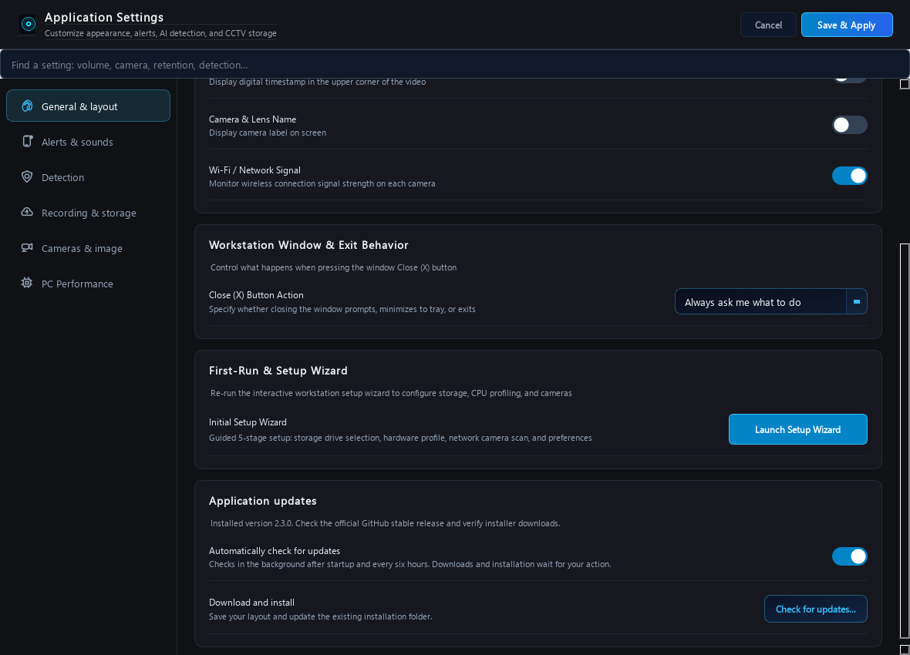

### Startup responsiveness

The installed app now uses a runtime folder instead of unpacking a large executable into a temporary folder on every launch. Setup remains one downloadable EXE. A simple loading screen replaces the animated intro and its forced delay. Filesystem cleanup and quota scans run in a background worker after the first minute, respecting existing retention and confirmation preferences. These changes remove known startup work; launch time still depends on the PC, antivirus scanning, storage and configured cameras.

## Run from source

**Requirements:** Windows 10 or 11 (64-bit), Python 3.11+, and Git.

```powershell
git clone https://github.com/SKIZZOO/CCTVPanelView.git
cd CCTVPanelView
python -m venv .venv
.\.venv\Scripts\Activate.ps1
python -m pip install -r requirements.txt
python main.py
```

If environment activation is blocked, invoke `.venv\Scripts\python.exe` directly. Use `cameras_config.example.json` as a reference; keep real camera passwords and notification secrets private.

## Add a camera

At first launch, open the setup flow or choose **Add Camera**. Enter the camera’s address, RTSP/ONVIF ports, credentials, and stream profile or URL. Test the connection and save it. Camera stream paths and ONVIF features vary across manufacturers, so consult your camera’s documentation if the provided profile does not work.

Select a 1, 2, 4, or 9 tile layout, then assign configured cameras to tiles. Recording, storage, motion detection, AI options, and notifications are managed from Settings.

## Use the mobile web viewer

In the desktop app, select **More → Mobile access**, then copy or scan the complete access link. Open it on a phone or tablet on the same trusted network. The link grants access to the web session, so treat it like a password. It and its browser sessions expire when the server restarts.

The web server uses HTTP. Keep it on a trusted LAN or use a trusted VPN. For access over an untrusted network, place it behind an HTTPS reverse proxy and preserve the original Host header. Do not expose the plain HTTP server directly to the public internet. Headless mode prints its private link to its local console; protect the console and logs.

## Settings at a glance

- **Appearance:** window and display behavior.
- **Storage:** recording location and retention.
- **Motion and AI:** motion sensitivity and optional local YOLOv5 ONNX detection.
- **Notifications:** configure available phone and desktop notification options.

Availability can depend on the camera, notification provider, and settings in use.

### Tune detection for the scene

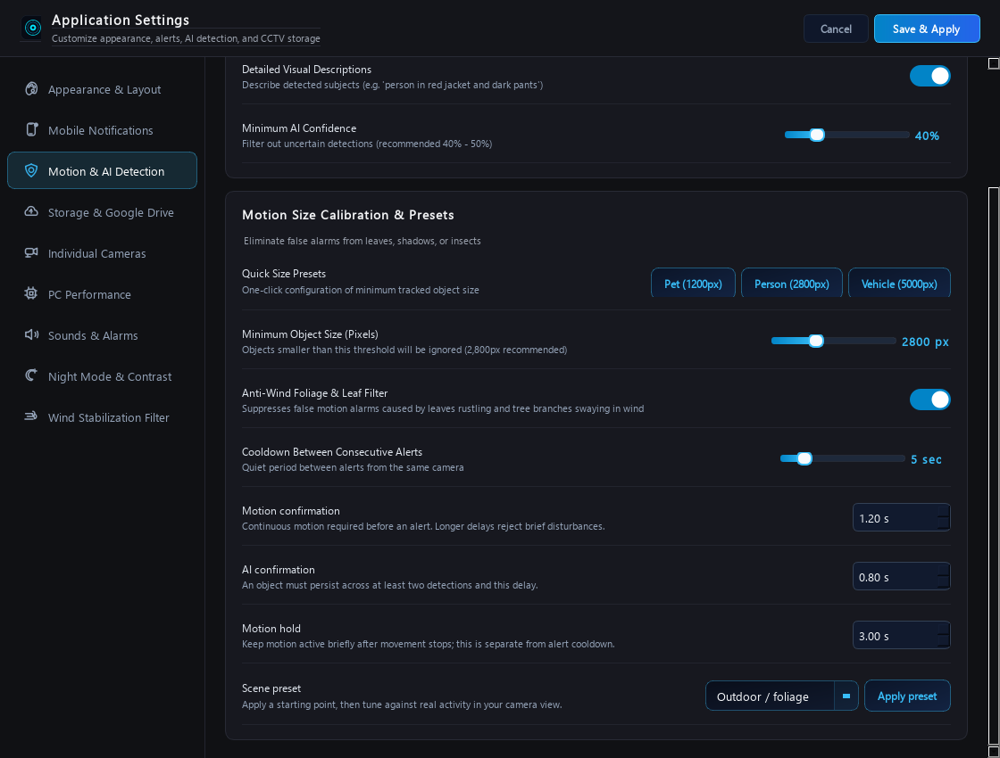

Start with an **Outdoor**, **Indoor**, or **Fast crossing** preset, then observe real activity and adjust:

| Setting | What it controls |
| --- | --- |
| Minimum object size | Rejects small motion contours, measured in source-frame pixels. Recalibrate if stream resolution changes. |
| Minimum AI confidence | Rejects uncertain classifications. Higher values can reduce false positives and miss more objects. |
| Motion confirmation | How long solid movement must continue before motion confirms. |
| AI confirmation | How long an object must persist across at least two detections. |
| Motion hold | Keeps motion active briefly after movement stops. |
| Alert cooldown | Minimum spacing between consecutive alerts from a stream. |

The background model warms up before motion alerts become active. Lighting shifts reset pending motion. Arming/disarming preserves your choices. Layout, empty tiles, hidden assignments, window size/position, and sidebar state are saved when you exit and restored at startup.

## Keyboard shortcuts

| Shortcut | Action |
| --- | --- |
| `F11` | Toggle fullscreen |
| `Esc` | Exit fullscreen or restore the grid |
| `1`, `2`, `4`, `9` | Choose a tile layout |
| `Ctrl + ,` | Open Settings |
| `Ctrl + S` | Save camera configuration |
| `Ctrl + M` | Toggle global motion detection |
| Double-click a tile | Maximize or restore it |
| Mouse wheel over video | Zoom; drag to pan while zoomed |
| Right-click a tile | Open available camera actions |

## Security and privacy

The web viewer requires a per-launch access link and session cookie. The access link is a shared capability: anyone who has it can access the web session until the server restarts. Keep camera and notification secrets out of source control and protect the local configuration files.

Direct API clients exchange the access code using `POST /api/session` with JSON and retain the returned session cookie. State-changing requests use JSON POST. Remote camera deletion is not supported; manage cameras in the desktop app.

See [the UI, reliability, scaling, and security review](docs/REVIEW-2026-10-24.md) for the implemented changes, test results, and known limitations. Automated tests use local fixtures and simulated workers; they do not test physical cameras, installers, or long-duration recording.

## Run the tests

```powershell
python -m unittest discover -s tests -v
```

## Build a Windows installer

Install `requirements.txt` and `requirements-build.txt` in a Windows virtual environment. Obtain a Windows FFmpeg build containing `ffmpeg.exe`, `ffplay.exe`, and `ffprobe.exe`, then run:

```powershell
python tools/build_windows.py --ffmpeg-dir C:\path\to\ffmpeg\bin
```

The build produces the app, uninstaller, and setup executable in `dist/` and runs an offline packaged-app check. See [release validation](docs/RELEASE-2.1.0.md) and [third-party notices](docs/THIRD_PARTY_NOTICES.md).

## License

[MIT](LICENSE)

## Watch incident videos in ntfy

Enable **Send Video Clip to Phone** in CCTVPanelView settings. After recording finishes, one high-priority notification carries the real MP4 attachment with its video type, size and expiry metadata. On iPhone, **tap the MP4 attachment to download it, then tap it again to play** in the native preview. Use the attachment menu to save/share a downloaded copy. The misleading second Open video notification from 2.3.2 is removed.

Previews include up to the first 60 seconds, use at most 640×360 at 12 fps, and stay below 850 KB. Full recordings stay untouched on your PC. Existing outgoing category preferences apply to clips too.

**Expired is not a codec error:** ntfy normally deletes server attachments after 3 hours. Old notifications cannot retrieve deleted files. Open/download new clips promptly and save important ones. On iPhone check ntfy Settings → Download attachments; choose a threshold covering the preview size (for example 1 MB). Auto-download behavior depends on the installed ntfy version and iOS background limits; opening ntfy promptly and manually downloading is the reliable fallback. CCTVPanelView cannot force an iPhone to download in the background or change ntfy's server retention.

For longer server retention use a suitable ntfy plan or your own configured ntfy server; this app does not automatically subscribe, charge, or expose your local recordings. [ntfy attachments and limits](https://docs.ntfy.sh/publish/#attachments), [ntfy iOS releases](https://github.com/binwiederhier/ntfy/blob/main/docs/releases.md).

### Full recordings, including 100 MB files, through Google Drive

In **Settings → Phone notifications**, choose **Full recording: Google Drive folder**, then **Choose folder** and select a synced folder on Drive for desktop's virtual drive. The app detects its private browser link automatically from Drive's local folder metadata. No pasted link, Google password or API setup is required. Keep sharing **Restricted** and use your permitted Google account on the phone.

Completed recordings already inside the selected folder are left in place. Other recordings are copied there in background with bounded memory, leaving originals unchanged. ntfy sends **Open Google Drive folder**, the recording's filename and its size. Open the folder and select that file after Drive finishes syncing/processing. The video bytes are not uploaded to ntfy, so its attachment-size limit does not apply. Drive quota/sync/playback limits still apply. The button opens the folder, not the exact video automatically; the notification confirms local recording/copy only, never successful cloud upload.

Automatic link detection requires Drive for desktop to expose a real cloud folder ID. Normal local folders, unsupported mirrored folders, unavailable drives and folders awaiting their first sync show a clear error instead of a guessed link. The app does not scrape Drive's database, read Google credentials, change sharing or install/configure Drive for desktop. This local metadata behavior may vary across Drive versions.

Small MP4 attachment mode remains available; outgoing category filters apply to both modes. Google Drive playback opens in its app/browser, rather than ntfy's native attachment preview.

## Animated startup and Windows taskbar icons

The animated camera intro runs in its own lightweight process while the workstation loads, so application imports and window construction do not freeze the animation. It hands over as soon as the main window is ready, without a forced startup delay, and closes automatically if the main process exits. Click or press Escape to skip the intro.

Windows shortcuts use the executable's embedded icon and the same app identity as the running app. Upgrades restore legacy icon paths used by older pinned shortcuts. The installer creates native Windows shortcuts without temporary script launchers.

## Available updates at the top of the app

When a background check finds a newer stable release, a banner appears below the top toolbar. While CCTVPanelView is active, a prompt offers **Update now** or **Not now** once per new version each session. Update now opens the verified download flow; installation still requires **Install and restart**. Not now keeps the banner available through **Review update** and does not download or install anything. Hidden/minimized/background windows wait until the app is active before prompting. Checks remain optional under Settings.

## Support the project

CCTVPanelView is free and open source. If it helps you keep an eye on your cameras, you can support its development with a contribution on Ko-fi.

### [♥ Support CCTVPanelView on Ko-fi](https://ko-fi.com/skidesign)

Contributions are optional and appreciated. You can also help by reporting bugs, sharing feedback or contributing improvements on GitHub.
