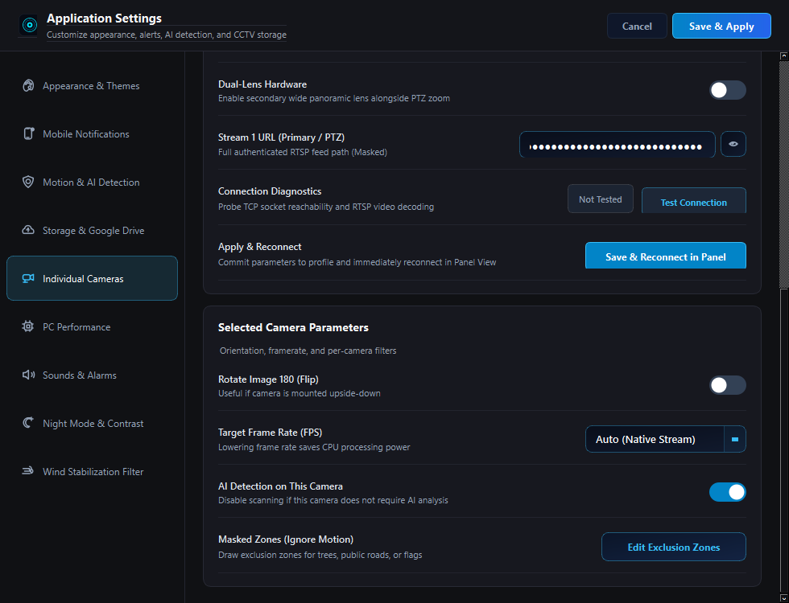
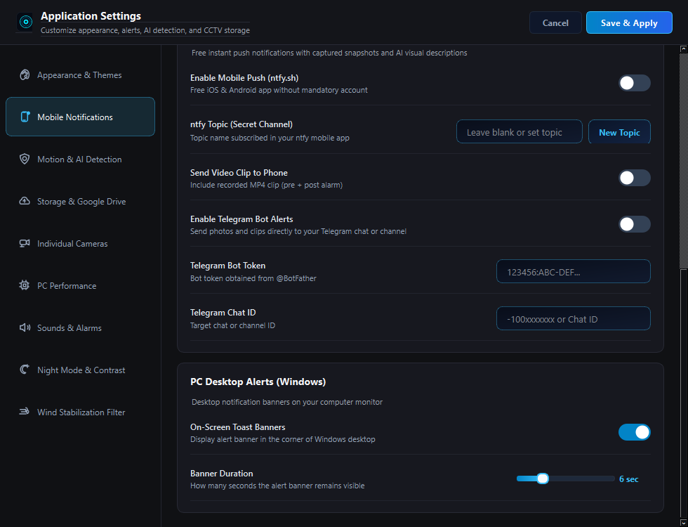

# CCTVPanelView

<div align="center">


### CCTV monitoring and recording for Windows

A desktop viewer for RTSP/ONVIF IP cameras, with motion alerts, optional on-device object detection, local recording, and a browser interface for phones and tablets.

[**Download for Windows**](https://github.com/SKIZZOO/CCTVPanelView/releases/latest) · [Features](#what-you-can-do) · [Quick start](#install-the-windows-release) · [Security](#web-access-and-security) · [Test report](docs/REVIEW-2026-10-24.md)


</div>

---

## What you can do

| Live monitoring | Recording and alerts | Browser access |
| --- | --- | --- |
| View cameras in 1, 2, 4, or 9 tile layouts. Maximize a tile, zoom, and use supported camera controls. | Record video, save snapshots, set storage and retention options, and configure motion or object alerts. | Open the optional web viewer on a phone, tablet, or another browser. View supported camera feeds, alerts, and PTZ actions. |

CCTVPanelView is designed for trusted home and small-site networks. Camera compatibility and performance depend on the camera model, stream format, PC, and network. It has not been benchmarked for a fixed camera count.

## Screenshots

### Desktop setup and camera management

<table>
<tr>
<td width="50%"><br><sub>Choose initial setup tasks at first launch.</sub></td>
<td width="50%"><br><sub>Add a camera and enter its connection details.</sub></td>
</tr>
<tr>
<td width="50%"><br><sub>Assign a configured camera to a video tile.</sub></td>
<td width="50%"><br><sub>Install the packaged Windows application.</sub></td>
</tr>
</table>

### Settings

Use Settings to adjust appearance, recording and storage, motion/object detection, and notification options.

<table>
<tr>
<td width="50%"><br><sub>Appearance and window behavior.</sub></td>
<td width="50%"><br><sub>Recording location and retention settings.</sub></td>
</tr>
<tr>
<td width="50%"><br><sub>Motion and local object-detection options.</sub></td>
<td width="50%"><br><sub>Configure supported notification channels.</sub></td>
</tr>
</table>

## Install the Windows release

1. Open [the latest release](https://github.com/SKIZZOO/CCTVPanelView/releases/latest).
2. Download and extract `CCTVPanelView-v2.0-Setup.zip`.
3. Run `CCTVPanelView-Setup.exe` from the extracted folder and follow the setup prompts.

The release ZIP contains the installer; the installer executable is inside the archive.

## Run from source

**Requirements:** Windows 10 or 11 (64-bit), Python 3.11+, and Git.

```powershell
git clone https://github.com/SKIZZOO/CCTVPanelView.git
cd CCTVPanelView
python -m venv .venv
.\.venv\Scripts\Activate.ps1
python -m pip install -r requirements.txt
python main.py
```

If environment activation is blocked, invoke `.venv\Scripts\python.exe` directly. Use `cameras_config.example.json` as a reference; keep real camera passwords and notification secrets private.

## Add a camera

At first launch, open the setup flow or choose **Add Camera**. Enter the camera’s address, RTSP/ONVIF ports, credentials, and stream profile or URL. Test the connection and save it. Camera stream paths and ONVIF features vary across manufacturers, so consult your camera’s documentation if the provided profile does not work.

Select a 1, 2, 4, or 9 tile layout, then assign configured cameras to tiles. Recording, storage, motion detection, AI options, and notifications are managed from Settings.

## Use the mobile web viewer

In the desktop app, select **More → Mobile access**, then copy or scan the complete access link. Open it on a phone or tablet on the same trusted network. The link grants access to the web session, so treat it like a password. It and its browser sessions expire when the server restarts.

The web server uses HTTP. Keep it on a trusted LAN or use a trusted VPN. For access over an untrusted network, place it behind an HTTPS reverse proxy and preserve the original Host header. Do not expose the plain HTTP server directly to the public internet. Headless mode prints its private link to its local console; protect the console and logs.

## Settings at a glance

- **Appearance:** window and display behavior.
- **Storage:** recording location and retention.
- **Motion and AI:** motion sensitivity and optional local YOLOv5 ONNX detection.
- **Notifications:** configure available phone and desktop notification options.

Availability can depend on the camera, notification provider, and settings in use.

## Keyboard shortcuts

| Shortcut | Action |
| --- | --- |
| `F11` | Toggle fullscreen |
| `Esc` | Exit fullscreen or restore the grid |
| `1`, `2`, `4`, `9` | Choose a tile layout |
| `Ctrl + ,` | Open Settings |
| `Ctrl + S` | Save camera configuration |
| `Ctrl + M` | Toggle global motion detection |
| Double-click a tile | Maximize or restore it |
| Mouse wheel over video | Zoom; drag to pan while zoomed |
| Right-click a tile | Open available camera actions |

## Security and privacy

The web viewer requires a per-launch access link and session cookie. The access link is a shared capability: anyone who has it can access the web session until the server restarts. Keep camera and notification secrets out of source control and protect the local configuration files.

Direct API clients exchange the access code using `POST /api/session` with JSON and retain the returned session cookie. State-changing requests use JSON POST. Remote camera deletion is not supported; manage cameras in the desktop app.

See [the UI, reliability, scaling, and security review](docs/REVIEW-2026-10-24.md) for the implemented changes, test results, and known limitations. Automated tests use local fixtures and simulated workers; they do not test physical cameras, installers, or long-duration recording.

## Run the tests

```powershell
python -m unittest discover -s tests -v
```

## License

[MIT](LICENSE)
