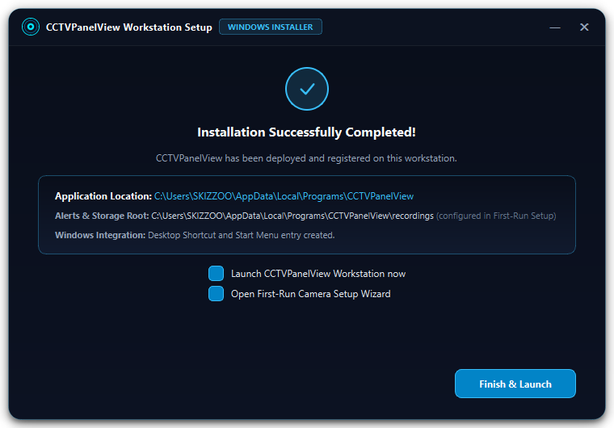
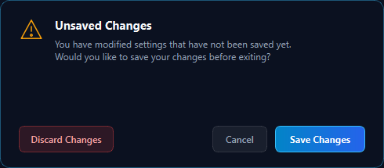

<div align="center">


# CCTVPanelView

### Next-Generation AI CCTV Surveillance Workstation & NVR for Windows

[](https://github.com/SKIZZOO/CCTVPanelView)
[](https://www.python.org/)
[](https://github.com/SKIZZOO/CCTVPanelView)
[](https://github.com/SKIZZOO/CCTVPanelView)
[](LICENSE)
[](https://github.com/SKIZZOO)

<p align="center">
  <b>A state-of-the-art, local-first CCTV surveillance workstation and NVR engineered specifically for multi-lens dual-stream IP cameras.</b><br>
  Featuring real-time on-device neural object detection, anti-wind foliage filtering, high-speed multi-feed synchronization, instant push alerts, and an Obsidian Cyber Dark interface.
</p>

[Key Features](#key-features) • [Installation Guide](#installation-guide) • [First-Time Setup](#first-time-setup--camera-configuration) • [Settings Center](#workstation-settings-center) • [Web & Mobile Hub](#remote-web--mobile-streaming-hub) • [Keyboard Shortcuts](#keyboard-shortcuts--controls) • [Credits](#credits--author)

</div>

---

## Overview

**CCTVPanelView** is a high-performance Windows CCTV workstation and NVR built from the ground up for modern dual-lens and multi-stream security cameras (including Jooan, CAM720, Xiongmai, Hikvision, Dahua, and generic ONVIF Profile S devices).

Unlike cloud-dependent commercial systems, CCTVPanelView operates **100% locally on your LAN**. No cloud subscriptions, no telemetry, no monthly fees, and no third-party data tracking. Video streams are decoded with low-latency hardware acceleration, evaluated using local neural vision models, and recorded directly to your storage drives.

---

## Key Features

### 1. On-Device Neural Vision (YOLOv5 ONNX)
- Real-time classification of detected entities into **Person**, **Car**, **Truck**, **Motorcycle**, **Bicycle**, and **Animals** (Dog, Cat).
- Direct bounding box visualization with confidence score indicators and custom color-coded category badges.
- Parked vehicle persistence: Confirmed stationary vehicles maintain subtle on-screen presence without triggering repeated notification chimes.

### 2. Anti-Wind Foliage & Leaf Flutter Filter
- Eliminates false motion triggers caused by rustling tree branches, bush leaves, and wind gusts.
- Employs an elliptical morphological opening kernel (`7x7 cv2.MORPH_ELLIPSE`) that dissolves scattered leaf clusters before contour extraction while preserving solid bodies (pedestrians and vehicles).
- Incorporates mathematical solidity and compactness boundary filtering:
  $$\text{Solidity} = \frac{\text{Contour Area}}{\text{Convex Hull Area}} < 0.38 \quad \text{or} \quad \text{Compactness} = \frac{\text{Perimeter}^2}{\text{Area}} > 65.0$$
- Irregular, porous foliage movement is tagged as `IGNORED: LEAF/WIND` in the Movement Diagnostic View without raising alarms.

### 3. Dual-Lens Stream Orchestration
- Seamless simultaneous decoding of **Telephoto PTZ** and **Ultra-Wide Panoramic** channels on dual-lens optical cameras.
- Unified audio-talk backchannel integration with 16kHz PCM audio broadcast.
- Automatic RTSP credential injection across both primary channel (`/live/ch00_0`) and secondary channel (`/live/ch01_0`).

### 4. Multi-Channel Phone & Web Alerts
- Instant push notifications with high-resolution snapshot thumbnails dispatched in under 1 second.
- Supported channels:
  - **ntfy.sh**: Zero-configuration instant mobile push notifications.
  - **Telegram Bot**: Photo and video clip messages sent directly to your Telegram chat or channel.
  - **Discord Webhook**: Rich embedded cards sent to dedicated security Discord channels.
  - **Native Windows Notifications**: Desktop toast banners with quick dismiss actions.

### 5. Obsidian Cyber Dark Interface
- Precision-crafted frameless dark UI inspired by Windows 11 Fluent and Obsidian aesthetics.
- Custom vector controls, glowing neon status capsules, animated reticles, and zero emojis for a clean, professional security workstation appearance.
- Smooth maximized and restored window transitions with custom title bar dragging and snap integration.

### 6. Local LAN Web Streaming & Mobile PWA Hub
- Built-in multi-threaded HTTP/MJPEG streaming server (`http://YOUR_PC_IP:8080`).
- Mobile-optimized responsive interface with interactive camera switching, live alerts feed, and PTZ controls.
- Dynamic QR code generation for instant one-click pairing from smartphones and tablets.

### 7. Resource Optimization & Low Footprint
- Sub-100MB idle RAM working set.
- Hardware-accelerated decoding pipelines with automatic direct frame dropping under background load to prevent video lag and memory accumulation.

---

## Installation Guide

### Option A: Standalone Windows Installer (Recommended)

1. Download the latest `CCTVPanelView-v2.0-Setup.zip` or `CCTVPanelView-Setup.exe` from the [Releases](https://github.com/SKIZZOO/CCTVPanelView/releases) page.
2. Run **`CCTVPanelView-Setup.exe`**.
3. The modern Obsidian Glass deployment wizard will guide you through the process:

<div align="center">

| 1. Installer Welcome | 2. Deployment Complete |
| :---: | :---: |
|  |  |

</div>

4. The installer automatically creates Start Menu shortcuts and a Desktop launcher.
5. Click **Launch CCTVPanelView** to begin.

---

### Option B: Running from Source

#### Prerequisites
- Windows 10 or 11 (64-bit)
- Python 3.11, 3.12, or 3.13
- Git for Windows

#### Setup Steps

1. Clone the repository:
   ```bash
   git clone https://github.com/SKIZZOO/CCTVPanelView.git
   cd CCTVPanelView
   ```

2. Create and activate a Python virtual environment:
   ```powershell
   python -m venv .venv
   .\.venv\Scripts\Activate.ps1
   ```

3. Install required dependencies:
   ```powershell
   pip install -r requirements.txt
   ```

4. Launch the application:
   ```powershell
   python main.py
   ```

---

## First-Time Setup & Camera Configuration

When launching CCTVPanelView for the first time, the application welcomes you with an animated reticle splash screen followed by the First-Time Setup Prompt.

<div align="center">

| First-Time Setup Prompt | Interactive Camera Configuration Wizard |
| :---: | :---: |
|  |  |

</div>

### Adding Your Cameras

1. Click **Configure Cameras** on the startup prompt or click the **[+] Add Camera** button on the sidebar.
2. Enter your camera parameters:
   - **Camera Name**: Descriptive label (e.g. `Front Yard`, `Garage Entrance`).
   - **IP Address**: The camera's local IPv4 address (e.g. `192.168.1.100`).
   - **RTSP Port**: Default is `554`.
   - **ONVIF Port**: Default is `8899` (or `80`, `5000` depending on model).
   - **Username**: Camera administrator username (defaults to `admin`).
   - **Password**: Camera stream password.
   - **Stream Profiles**: Select `Dual-Lens (Primary + Secondary)` or `Single-Lens 2K`.
3. Press **Enter** or click **Test Connection** to verify live feed handshake.
4. Click **Save Camera**.

### Quick Slot Assignment

If a video tile has no camera assigned, simply click on the tile to open the quick assignment modal:

<div align="center">
  
</div>

Select the camera from the dropdown and click **Assign to Slot**.

---

## Workstation Settings Center

Open the Settings Center by clicking the **Gear** icon on the top navigation bar or pressing `Ctrl + ,`.

<div align="center">

| Appearance & Window Controls | Mobile & Web Push Notifications |
| :---: | :---: |
|  |  |

| Storage & Video Retention Quotas | AI Vision & Anti-Wind Foliage Filter |
| :---: | :---: |
|  |  |

</div>

### Key Settings Highlights
- **Appearance**: Toggle custom window title bar, frameless aero borders, and compact top bar modes.
- **Notifications**: One-click Master Security toggle to enable/disable all phone push notifications (ntfy.sh, Telegram, Discord).
- **Storage**: Set dedicated recording directories, snapshot folders, and automatic retention limits (10GB - 500GB).
- **AI & Motion**: Configure minimum motion area (`2,800 px` default), toggle the **Anti-Wind Foliage & Leaf Filter**, and set confidence thresholds for vehicles and pedestrians.
- **Unsaved Changes Guard**: Built-in dialog prevents accidental loss of configuration adjustments.

<div align="center">
  
</div>

---

## Remote Web & Mobile Streaming Hub

CCTVPanelView includes a built-in web server and Progressive Web App (PWA) hub for monitoring your cameras remotely from any smartphone, tablet, or web browser on your LAN:

- **Protected Access**: Open **More → Mobile access** and copy or scan the complete per-launch access link. The link contains a private access code and expires when the server restarts. A bare address prompts for that code. Use a trusted LAN/VPN or HTTPS reverse proxy for remote access.
- **Mobile PWA Support**: Add to home screen on iOS and Android for a native app experience.
- **Interactive Controls**: Switch between camera channels, view real-time incident cards, and operate PTZ cameras remotely.

---

## Supported Camera Models & RTSP Patterns

CCTVPanelView supports any IP camera that provides standard RTSP or ONVIF Profile S streams.

| Manufacturer / Model | Channel Type | Typical RTSP Path | Notes |
| :--- | :--- | :--- | :--- |
| **CAM720 / Jooan Dual-Lens** | Primary (Fixed Wide) | `rtsp://IP:554/live/ch00_0` | High-definition 2K / 3MP stream |
| **CAM720 / Jooan Dual-Lens** | Secondary (PTZ Zoom) | `rtsp://IP:554/live/ch01_0` | Synchronized secondary PTZ channel |
| **Xiongmai (XM) IP Cameras** | Main Stream | `rtsp://IP:554/user=admin&password=...&channel=1&stream=0.sdp` | Full ONVIF Profile S |
| **Hikvision IP Cameras** | Main Stream | `rtsp://IP:554/Streaming/Channels/101` | Channel 1, Main stream |
| **Dahua IP Cameras** | Main Stream | `rtsp://IP:554/cam/realmonitor?channel=1&subtype=0` | Channel 1, High-profile |
| **Generic ONVIF Profile S** | Primary Stream | `rtsp://IP:554/onvif1` | Standard ONVIF profile |

---

## Keyboard Shortcuts & Controls

| Shortcut | Action |
| :--- | :--- |
| **F11** | Toggle Borderless Fullscreen Mode |
| **Escape** | Exit Fullscreen / Restore Grid from Solo Maximize |
| **1** | Solo Tile Layout (1x1) |
| **2** | Dual Split Layout (1x2) |
| **4** | Quad Grid Layout (2x2) |
| **9** | Multi-View Grid Layout (3x3) |
| **Ctrl + ,** | Open Workstation Settings Center |
| **Ctrl + S** | Save Current Camera Configuration |
| **Ctrl + M** | Toggle Global Motion Detection On / Off |
| **Double-Click Tile** | Maximize selected camera tile to full grid / restore |
| **Mouse Wheel (on Video)** | Smooth Digital Zoom (1.0x to 5.0x) |
| **Click & Drag (when zoomed)** | Pan around within zoomed video viewport |
| **Right-Click Tile** | Open context menu (Quality profile, PTZ, Snapshot, Record) |

---

## Architecture

```
                  ┌───────────────────────────────────────────────┐
                  │          IP Security Cameras (LAN)            │
                  │  (CAM720, Jooan, Xiongmai, Hikvision, Dahua)  │
                  └──────┬────────────────────────────────┬───────┘
                         │ RTSP (/live/ch00_0)            │ ONVIF / PTZ
                         ▼                                ▼
┌────────────────────────────────────────────────────────────────────────┐
│                        CCTVPanelView Core Engine                       │
│                                                                        │
│   ┌───────────────────────────┐    ┌───────────────────────────────┐   │
│   │    RTSP Stream Workers    │    │      PTZ & Talk Controller    │   │
│   │  - Hardware Accel H.264   │    │  - 8-Way Pan/Tilt/Zoom        │   │
│   │  - Low Latency Buffer     │    │  - Preset Cycling             │   │
│   │  - Direct Frame Drop      │    │  - 16kHz PCM Audio Stream     │   │
│   └─────────────┬─────────────┘    └───────────────────────────────┘   │
│                 │ Frame                                                │
│                 ▼                                                      │
│   ┌───────────────────────────┐    ┌───────────────────────────────┐   │
│   │    Motion Detector MOG2   │    │      YOLOv5 ONNX Neural AI    │   │
│   │  - 7x7 Morphological Open │───▶│  - Person, Car, Truck, Dog    │   │
│   │  - Solidity & Compactness │    │  - Color & Silhouette Crop    │   │
│   │  - Anti-Wind Foliage Rej. │    │  - Confidence Scoring         │   │
│   └─────────────┬─────────────┘    └───────────────┬───────────────┘   │
│                 │ Valid Motion Trigger             │ Object Tag        │
│                 └─────────────────┬────────────────┘                   │
│                                   ▼                                    │
│                 ┌───────────────────────────────────┐                  │
│                 │    Incident Dispatcher & NVR      │                  │
│                 │  - MP4 Clip Recorder (H.264)      │                  │
│                 │  - JPEG Snapshot Generator        │                  │
│                 │  - Push Dispatch (ntfy/TG/Discord)│                  │
│                 └─────────────────┬─────────────────┘                  │
└───────────────────────────────────┼────────────────────────────────────┘
                                    │
           ┌────────────────────────┴────────────────────────┐
           ▼                                                 ▼
┌─────────────────────────────────────┐   ┌─────────────────────────────────────┐
│       Obsidian Qt6 GUI Client       │   │        LAN Web & Mobile Hub         │
│  - Multi-Grid Synchronizer          │   │  - MJPEG Multi-Camera Stream        │
│  - Dynamic Badge & Reticle Overlay  │   │  - Responsive Mobile PWA            │
│  - Alert Incident Cards             │   │  - QR Code Pairing                  │
│  - Settings Center & Diagnostics    │   │  - Remote PTZ Controls              │
└─────────────────────────────────────┘   └─────────────────────────────────────┘
```

---

## Building from Source (PyInstaller)

To compile your own standalone executables:

```powershell
# 1. Compile the main application executable
pyinstaller --noconfirm CCTVPanelView.spec

# 2. Copy the binary to the root directory for the installer bundle
copy dist\CCTVPanelView.exe .\CCTVPanelView.exe

# 3. Compile the standalone modern setup wizard
pyinstaller --noconfirm CCTVPanelView-Setup.spec
```

The resulting binaries will be available in the `dist\` directory.

---

## Credits & Author

**CCTVPanelView** is conceived, designed, and developed by:

### **SKIZZOO**
- **Role**: Founder, Lead Architect & Developer
- **GitHub**: [@SKIZZOO](https://github.com/SKIZZOO)
- **Project**: CCTVPanelView Workstation Suite

Special thanks to the open-source community behind **PyQt6**, **OpenCV**, and **Ultralytics YOLOv5**.

---

## License

This project is licensed under the **MIT License** — see the [LICENSE](LICENSE) file for details.
All rights reserved © 2026 **SKIZZOO**.


## Validation and security review

Run `python -m unittest discover -s tests -v` after installing requirements. See [the review](docs/REVIEW-2026-10-24.md) for changes, compatibility notes, test evidence, and remaining work.
